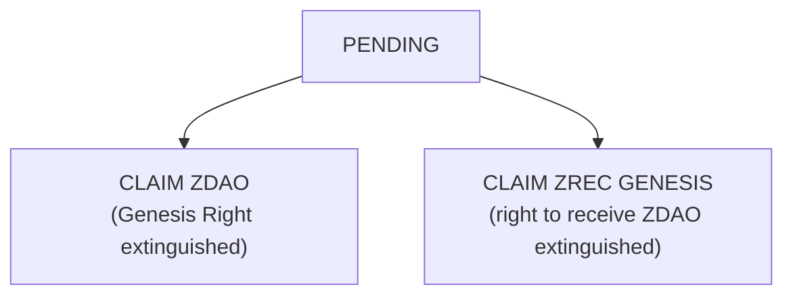
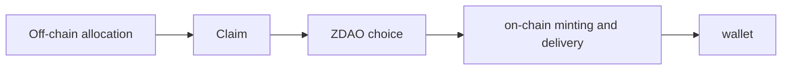
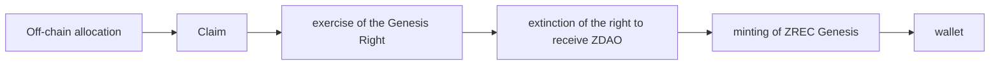
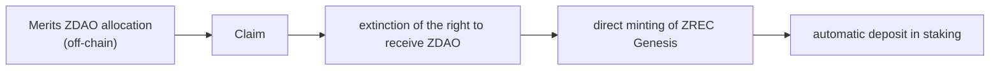

<!-- Origen: ZERO-ENERGY-Especificacion-Tecnica-v2.0.md -->

# 5. FOUNDATIONAL PHASE: PRESALE, CLAIM AND GENESIS

## 5.1 Presale

Initial funding mechanism. Allocations are recorded **off-chain**; ZDAO are minted solely through the Official Claim System after launch. This decoupling between funding and effective issuance enables a verifiable distribution with no pre-minting.

**Maximum allocation: 200,000,000 ZDAO** (20 % of MAX_SUPPLY). The tranche percentages are calculated **over those 200,000,000**, not over the global MAX_SUPPLY.

|  |  |  |  |  |  |
| --- | --- | --- | --- | --- | --- |
| **Tranche** | **% of Presale** | **Amount** | **Price** | **Minimum investment** | **Raised** |
| 1 | 0 % – 5 % | 10,000,000 | 0.10 USDC | 1,000 USDC | 1,000,000 |
| 2 | 5 % – 15 % | 20,000,000 | 0.25 USDC | 500 USDC | 5,000,000 |
| 3 | 15 % – 40 % | 50,000,000 | 0.50 USDC | 250 USDC | 25,000,000 |
| 4 | 40 % – 70 % | 60,000,000 | 0.65 USDC | 100 USDC | 39,000,000 |
| 5 | 70 % – 100 % | 60,000,000 | 0.75 USDC | 10 USDC | 45,000,000 |
| Total |  | 200,000,000 | 0.575 average |  | 115,000,000 |

**The tranches operate in parallel.** Each tranche has an independent allocation and remains available until its units are exhausted or until another closing condition established by the protocol occurs. **It is not necessary to exhaust one tranche to enable the next.** The minimum investment is the access criterion for each tranche.

**Unallocated supply.** Presale ZDAO that are not allocated are not minted and are not automatically transferred to any other program.

The resources obtained are allocated to the development of the blockchain and energy infrastructure, contract implementation and auditing, producer onboarding, ZERO DEX development and ecosystem growth.

## 5.2 Single Claim and Genesis window

**Claim and Genesis Issuance are not consecutive phases: they are a single operating window of six (6) months.**

The decision on asset onboarding is made **directly during the Claim**, based on the off-chain foundational record and **before the assets enter free circulation**. This removes the previous model of "Claim → receive ZDAO → subsequent conversion".

During the window:

* Presale participants choose between ZDAO or ZREC Genesis.
* Merits participants resolve their allocations directly into ZREC Genesis.
* The staking positions corresponding to the Merits ZREC are created.

Once the window closes, the ordinary possibility of exercising the Genesis Right closes as well.

⬜ **Pending protocol decision:** the definitive treatment of allocations that did not perform a Claim within the window. It is not established in this document because no express decision yet exists.

## 5.3 The Genesis Right

**Central concept of the foundational phase.**

The Genesis Right **is not a property of the ERC-20 ZDAO token**. It is a right associated exclusively with certain foundational allocations recorded off-chain, and it is resolved a single time during the Claim.

This architecture is a necessary consequence of the fungibility established in Section 2.4: an ERC-20 cannot distinguish the provenance of the tokens in a balance, so no origin-based restriction can be implemented on the token. It is implemented on the allocation.

**Single-consumption principle.** The allocation admits two terminal states:

Once either option is executed, the allocation is definitively consumed. Consequently:

* A second Claim cannot be performed on the same allocation.
* The Genesis Right cannot be recovered afterwards.
* **The sale or transfer of ZDAO does not transfer the Genesis Right.**
* It cannot be duplicated using different wallets.
* It cannot be exercised with ZDAO acquired on secondary markets.

This eliminates by design the vector: \*wallet A claims ZDAO → transfers them to wallet B → wallet B tries to exercise Genesis\*. The operation is impossible because the right was consumed in the initial Claim.

**This rule is a fundamental security principle of the protocol.**

## 5.4 Presale branch: single choice

Presale allocations **are free of Vesting**. During the Claim, the participant chooses between two mutually exclusive options.

**Option A — Direct Claim in ZDAO**

The ZDAO received are completely free, fungible and transferable, with no Vesting and no lock. The Genesis Right is consumed and extinguished: they may no longer be used to mint ZREC Genesis, and no subsequent acquirer will obtain any right whatsoever.

**Option B — Exercise of the Genesis Right**

Ratio: **1 Claim right over 1 Presale ZDAO = 1 ZREC Genesis**. The corresponding ZDAO are not minted, so **this operation does not constitute a burn**.

The ZREC Genesis thus obtained are **completely free**: no Vesting, no mandatory lock and no minimum staking stay. They may be held, transferred, sold, swapped, provided as liquidity, used in the ZERO DEX or voluntarily deposited in staking, with withdrawal according to the general rules.

This route gives Presale participants a direct entry into the protocol's energy economy and into ZREC staking.

## 5.5 Merits branch: conversion and automatic staking

The allocations of the Merits Program are recorded off-chain denominated in ZDAO, but **those ZDAO are not minted on-chain**.

Ratio: **1 ZDAO allocated through Merits = 1 ZREC Genesis**. Neither is there a burn here: the ZDAO were never minted.

**There is no Vesting contract.** Any Genesis Vesting Vault, independent Vesting contract or equivalent architecture is eliminated. The time restrictions are implemented **directly through the withdrawal rules of the position within the Official Staking System**.

The correct formulation is not "ZREC in Vesting → Staking", but **"Merits ZREC Genesis → Staking with a special withdrawal schedule"**.

**Availability schedule**

|  |  |  |
| --- | --- | --- |
| **Phase** | **Duration** | **Availability** |
| Initial lock | 6 months | 0 % |
| Progressive release | 50 months | 2 % monthly of the initial allocation |
| Total | 56 months | 100 % |

During the first six months, no principal may be withdrawn, nor the deposited ZREC sold or transferred, nor any mechanism intended to circumvent the lock used. The position participates in staking from day one.

Example — initial allocation of 100,000 ZREC

 Months 0-6 .... 0 ZREC available
 Month 7 ........ 2,000 ZREC available
 Month 8 ........ 4,000 ZREC available
 Month 31 ....... 50,000 ZREC available
 Month 56 ....... 100,000 ZREC available

Each monthly tranche that reaches its date may be withdrawn. **Once withdrawn, the ZREC is completely free** and equivalent to any other. The restriction affects exclusively the part of the position that has not yet reached its availability.

## 5.6 Official Claim System

**Prior consolidation.** Before opening the Claim, the allocation register is closed, a Merkle tree is generated with all allocations and their conditions, its root is published on-chain, and the complete set is published for independent verification. From that moment the set is immutable and any participant can verify their allocation without depending on the protocol.

**Execution.** The participant connects a Base-compatible wallet, obtains their proof of inclusion and submits it to the contract, which verifies the proof against the published root, checks that the allocation has not been consumed, resolves the corresponding branch and marks the allocation as permanently consumed.

This model is preferable to an authorization issued by a server: the published root fixes the set of allocations immutably and auditably **before a single asset is minted**, and no external infrastructure retains the ability to authorize minting. Any modification of the root requires DAO approval and the timelock of Section 8.
