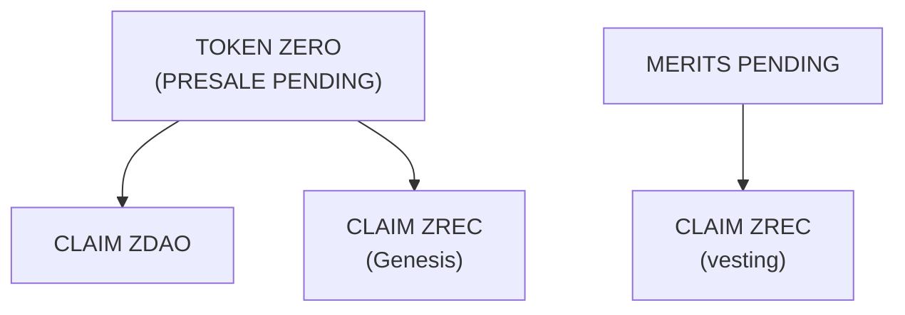
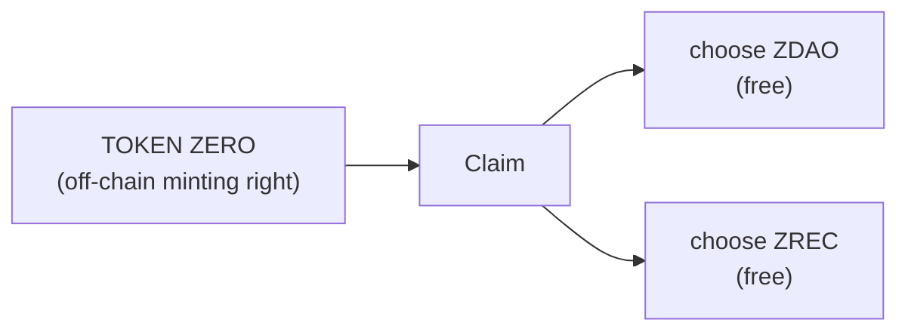
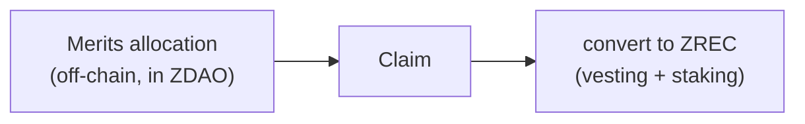

<!-- Origen: ZERO-ENERGY-Especificacion-Tecnica-v2.0.md -->

# 5. GENESIS PHASE: PRESALE, TGE AND CLAIM

## 5.1 Presale

Initial funding mechanism. Allocations are recorded **off-chain** under the Presale denomination **TOKEN ZERO**: each TOKEN ZERO is a **minting right** (a right of issuance), not a minted token. Minting occurs solely through the Official Claim System after launch, where the right is resolved into ZDAO or ZREC. This decoupling between funding and effective issuance enables a verifiable distribution with no pre-minting.

**Maximum allocation: 200,000,000 TOKEN ZERO** (equivalent to 20 % of MAX_SUPPLY). The tranche percentages are calculated **over those 200,000,000**, not over the global MAX_SUPPLY.

|  |  |  |  |  |  |
| --- | --- | --- | --- | --- | --- |
| **Tranche** | **% of Presale** | **TOKEN ZERO** | **Price** | **Minimum investment** | **Raised** |
| 1 | 0 % – 5 % | 10,000,000 | 0.10 USDC | 1,000 USDC | 1,000,000 |
| 2 | 5 % – 15 % | 20,000,000 | 0.25 USDC | 500 USDC | 5,000,000 |
| 3 | 15 % – 40 % | 50,000,000 | 0.50 USDC | 250 USDC | 25,000,000 |
| 4 | 40 % – 70 % | 60,000,000 | 0.65 USDC | 100 USDC | 39,000,000 |
| 5 | 70 % – 100 % | 60,000,000 | 0.75 USDC | 10 USDC | 45,000,000 |
| Total |  | 200,000,000 | 0.575 average |  | 115,000,000 |

The **Raised** column and the **0.575 average price** are **theoretical maxima**: they assume full subscription of all five tranches. Since tranches remain available until their units are exhausted, the actually raised amount may be lower.

**The tranches operate in parallel.** Each tranche has an independent allocation and remains available until its units are exhausted or until another closing condition established by the protocol occurs. **It is not necessary to exhaust one tranche to enable the next.** The minimum investment is the access criterion for each tranche.

**Unallocated supply.** Presale TOKEN ZERO that are not allocated are not minted and are not automatically transferred to any other program.

The resources obtained are allocated to the development of the blockchain and energy infrastructure, contract implementation and auditing, producer onboarding, ZERO DEX development and ecosystem growth.

## 5.2 Token Generation Event (TGE) and Claim window

**The TGE is the launch milestone that fixes the reference date and opens the Claim window.** It does not mint or distribute assets by itself: minting occurs only when a participant claims their allocation.

* The TGE fixes the reference date (`t0`) from which the Claim window and the Merits schedules are computed.
* The Claim window lasts **six (6) months** from the TGE.
* Presale participants exercise their **TOKEN ZERO** minting right, choosing at claim time between ZDAO or ZREC (both free of Vesting).
* Merits participants convert their allocations into ZREC with a vesting schedule (Section 5.5).
* The staking positions corresponding to Merits ZREC are created automatically.

Once the window closes, the possibility of claiming a Genesis allocation closes as well, and unclaimed allocations are treated according to the pending decision below.

⬜ **Pending protocol decision:** the definitive treatment of allocations that did not perform a Claim within the window. It is not established in this document because no express decision yet exists.

## 5.3 Claim choices

**There is no special "right" attached to a Genesis allocation.** Each allocation admits, at claim time, a plain choice with terminal consumption. Only Presale TOKEN ZERO allocations involve a choice; Merits allocations resolve directly into ZREC (Section 5.5).

Once an option is executed, the allocation is definitively consumed. Consequently:

* A second Claim cannot be performed on the same allocation.
* It cannot be duplicated using different wallets.
* It cannot be exercised with tokens acquired on secondary markets.

Because ZDAO and ZREC are ordinary fungible tokens (Sections 2.4 and 3.2), an ERC-20 cannot distinguish the provenance of the tokens in a balance. The choice is therefore resolved on the off-chain allocation record during the Claim, never on the token. This eliminates by design the vector \*wallet A claims → transfers to wallet B → wallet B tries to claim again\*: the operation is impossible because the allocation was consumed in the initial Claim.

## 5.4 Presale branch: ZDAO or ZREC

A **TOKEN ZERO** (the Presale minting right) resolves, at claim time, into either **ZDAO or ZREC**, at the participant's choice. Both options are **free of Vesting**: no lock, no mandatory staking stay.

Ratio: **1 TOKEN ZERO = 1 ZDAO or 1 ZREC**. There is no burn: the ZDAO of a ZREC choice are never minted.

* **ZDAO** — minted on-chain, completely free, fungible and transferable, with no lock.
* **ZREC** — minted on-chain, completely free, with no Vesting, no lock and no minimum staking stay. The participant may hold, transfer, sell, swap, provide as liquidity, or voluntarily deposit in staking under the general withdrawal rules.

This route gives Presale participants a direct entry into the protocol's energy economy and into ZREC staking.

## 5.5 Merits branch: ZREC with vesting

Merits allocations are recorded off-chain denominated in ZDAO. At claim time, the participant **converts the allocation into ZREC** (there is no ZDAO option). The ZREC is minted and **automatically deposited in staking**, where it remains producing ZDAO under a special withdrawal schedule.

Ratio: **1 ZDAO allocated through Merits = 1 ZREC**. There is no burn: the ZDAO are never minted.

**There is no Vesting contract.** The time restrictions are implemented **directly through the withdrawal rules of the position within the Official Staking System**. The correct formulation is **"Merits ZREC → Staking with a special withdrawal schedule"**.

The ZREC remain **in staking for the whole schedule**, producing ZDAO from day one. The ZDAO generated as rewards are **free and transferable immediately** (Section 6.5): the lock applies only to the deposited ZREC principal.

**Availability schedule**

|  |  |  |
| --- | --- | --- |
| **Phase** | **Duration** | **Availability** |
| Initial lock | 6 months | 0 % |
| Progressive release | 50 months | 2 % monthly of the initial allocation |
| Total | 56 months | 100 % |

During the first six months, no principal may be withdrawn, nor the deposited ZREC sold or transferred, nor any mechanism intended to circumvent the lock used. The position participates in staking from day one.

Example — initial allocation of 100,000 ZREC

 Months 0-6 .... 0 ZREC available
 Month 7 ........ 2,000 ZREC available
 Month 8 ........ 4,000 ZREC available
 Month 31 ....... 50,000 ZREC available
 Month 56 ....... 100,000 ZREC available

Each monthly tranche that reaches its date may be withdrawn. **Once withdrawn, the ZREC is completely free** and equivalent to any other. The restriction affects exclusively the part of the position that has not yet reached its availability.

## 5.6 Official Claim System

**Prior consolidation.** Before opening the Claim, the allocation register is closed, a Merkle tree is generated with all allocations and their conditions, its root is published on-chain, and the complete set is published for independent verification. From that moment the set is immutable and any participant can verify their allocation without depending on the protocol.

**Execution.** The participant connects a Base-compatible wallet, obtains their proof of inclusion and submits it to the contract, which verifies the proof against the published root, checks that the allocation has not been consumed, resolves the corresponding branch and marks the allocation as permanently consumed.

This model is preferable to an authorization issued by a server: the published root fixes the set of allocations immutably and auditably **before a single asset is minted**, and no external infrastructure retains the ability to authorize minting. Any modification of the root requires DAO approval and the timelock of Section 8.
