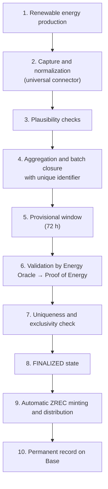

<!-- Origen: ZERO-ENERGY-Especificacion-Tecnica-v2.0.md -->

# 4. PROOF OF ENERGY AND ENERGY ORACLES

This section develops the layer that converts physical production into authorized ZREC issuance: what is certified, how the data is obtained, how it is validated, and how it is grouped for on-chain registration.

## 4.1 What the protocol certifies

**ZERO Energy certifies renewable energy that has actually been generated and validated, regardless of its subsequent destination** —self-consumption, storage, or export to grid— provided that production traceability is guaranteed and double counting of the associated energy or environmental attributes is prevented.

A producer that generates 1,000 MWh of renewable energy, self-consumes 300, and exports 700 to the grid has produced 1,000 MWh of renewable energy. If the protocol correctly verifies those 1,000 MWh at the point of generation, they are potentially 1,000 ZREC.

> **The destination of the electricity is not the problem. The problem is the environmental attribute.** If those 700 exported MWh have already generated or transferred guarantees of origin, renewable certificates, or another equivalent attribute outside ZERO Energy, they cannot simultaneously be presented as an exclusive certificate of the protocol without interoperability and cancellation rules. That is what the protocol must resolve, and it is addressed in the exclusivity verification of Section 4.3.

Any general rule that excluded energy exported to the grid would be technically incorrect —the protocol measures generation, not consumption— and would penalize precisely the professional producers, whose main activity is injecting energy into the grid.

## 4.2 Objectives of the validation layer

* Verify real renewable production and guarantee data authenticity.
* Prevent fraud, manipulation, and unauthorized issuance.
* **Avoid double counting**: each unit of energy is associated with a single issuance and, upon retirement, with a single certificate for a single purpose.
* Maintain an auditable record of all validations.

The non-duplication principle is transversal and binds the rest of the document.

## 4.3 Oracle model and progressive decentralization

**Initial model.** During the initial phase, energy validation is carried out by a **proprietary oracle authorized by ZERO Energy**.

> The document **does not present the initial infrastructure as a decentralized oracle network**, because technically it still is not one. Opening up to independent validators is a verifiable milestone of Section 8, not a statement of intent.

**Evolution.** The architecture is prepared to progressively admit multiple independent sources: smart meters, manufacturer APIs, inverters, SCADA, IoT systems, monitoring platforms, certifiers, external validators, and grid operators.

It is not mandatory for all installations to have the same number or type of sources. The architecture allows **trust rules adapted to each installation typology**: a home with self-consumption and a photovoltaic park do not require the same level of redundancy.

**Requirements for external validators.** Their incorporation will follow security and maturity criteria: independence from the validated producer, technical capability, verifiable identity when necessary, availability, data integrity and traceability, cryptographic security, operational history, absence of conflicts of interest, and audited integration.

> **The incorporation of a third party does not by itself constitute sufficient decentralization.** The goal is to evolve toward truly independent validation sources operating reliably in production for a sufficient period.

**Uniqueness registry.** The system maintains a registry of batch identifiers already processed. Any request referring to a previously registered identifier is automatically rejected, regardless of the oracle that submits it.

**Exclusivity verification.** Before authorizing an issuance, it must be verified that the declared production has not already generated an energy certificate in another system applicable to the installation. The procedure and the required documentation are approved by governance.

**Delimitation between source and oracle.** The source obtains and normalizes the data; the oracle verifies and signs it. A component that merely reads data does not acquire oracle status by doing so, regardless of its technical sophistication.

## 4.4 Data acquisition

**Universal connector.** The protocol integrates a connector capable of obtaining production data from installations of different manufacturers **without requiring additional hardware at the point of generation**: the holder selects the manufacturer of their inverter, authorizes access to their production data, and the connector normalizes it to a common format.

This model substantially reduces the entry barrier for residential microgeneration, the most numerous segment of the distributed infrastructure.

> **Shift in the trust model.** The absence of a device at the measurement point does not reduce the risk: it shifts it from meter manipulation toward the veracity of the declared installation and control of the manufacturer's account. That is why verification cannot rest on the received data and relies on the checks in 4.5 and 4.6.

## 4.5 Installation registration and verification

Before the first issuance, each installation is registered with: unique identifier, holder, location, **nominal power**, inverter manufacturer and model, and commissioning date.

**Nominal power is not accepted on the producer's declaration.** It is verified through three combined checks:

|  |  |  |
| --- | --- | --- |
|  | **Check** | **Content** |
| A | Documentation | Technical datasheet, certificate, or equivalent information of the installation |
| B | Identification | Verifiable link between the physical installation, holder, meter, inverter, and monitoring system |
| C | Empirical validation | Contrast between recorded production and the nominal capacity and physical characteristics |

Empirical validation turns nominal power into a **physical coherence barrier**: an installation registered as 10 kWp that systematically declares 500 kWh/h describes a physical impossibility, and the system can generate alerts, review, provisional suspension, or a request for additional information.

Plausibility checks applicable to any production data:

* Coherence with the registered nominal power.
* Coherence with the irradiance corresponding to location and date.
* Coherence with the weather conditions of the period.
* Coherence with the installation's own history, considering seasonality.
* Coherence with comparable installations in the same area and period.

These checks are **deterministic and reproducible** by any verifier with the same input data.

> **Deliberate limitation.** When anomaly detection incorporates machine learning models, their function is limited to **prioritizing cases for review**, with no capacity to authorize an issuance on their own. The authorization of a mint must be justifiable through verifiable rules: no component whose criterion is not reproducible may ground an issuance.

## 4.6 Energy batches

Production does not generate an on-chain transaction for each reading. Readings are aggregated into batches.

**Batch closure.** Initial configuration: **every 24 hours or upon reaching 1 MWh accumulated**, according to the configuration applicable to the installation and whichever occurs first. This hybrid criterion allows managing both a solar home and a photovoltaic park with the same architecture. Parameter modifiable by governance.

**Batch identifier.** Each batch receives a unique identifier that **is the identifier of the uniqueness registry of Section 4.3**. A batch already processed cannot be processed again, regardless of the number of attempts. From this derives the system's idempotency: if a settlement fails and is retried, the registry prevents double minting.

**Provisional status: 72 hours.** Once the batch is closed, a window opens during which data reconciliation, anomaly detection, source cross-checking, additional validations, and technically justified corrections may take place.

Upon reaching the **FINALIZED** state, the associated production is unequivocally identified as processed and cannot be reused in a second issuance. Minting is irreversible: the provisional window is the only mechanism that allows corrections to be incorporated. Its duration may later be reduced by governance for high-trust producers or oracles.

**Precision and residues.** The conversion of accumulated energy to ZREC is performed with 3 decimals (minimum 1 kWh). **The non-representable fraction is carried over to the next batch**; in no case is it discarded or rounded up. With a large number of low-power installations, a systematic rounding in either direction produces a material accumulated deviation between certified energy and issued ZREC.

## 4.7 Complete validation flow

