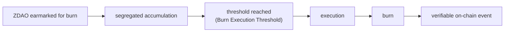

<!-- Origen: ZERO-ENERGY-Especificacion-Tecnica-v2.0.md -->

# 2. ZERO DAO (ZDAO)

ERC-20 governance and incentive token of the protocol, deployed on Base. **8 decimals**: the minimum unit is 0.00000001 ZDAO, the granularity required for the proportional calculation of rewards, fees, and distributions.

## 2.1 Supply magnitudes

The document distinguishes six magnitudes that must not be confused:

|  |  |
| --- | --- |
| **Magnitude** | **Definition** |
| MAX_SUPPLY | 1,000,000,000 ZDAO. Absolute ceiling, never exceedable |
| totalSupply | ZDAO currently in existence (minted minus burned). This is the **circulating metric** against which minting capacity is measured |
| Circulating supply | totalSupply minus locked positions |
| Minting capacity | `MAX_SUPPLY - totalSupply`. Recovered when ZDAO is burned |
| Off-chain allocations | Rights registered in Presale and Merits, not yet minted |
| Burned ZDAO | Permanently destroyed; reduces `totalSupply` |

**Invariant:** `totalSupply <= MAX_SUPPLY`, verified on every mint.

ZDAO is **mintable and burnable**: it is minted against legitimate accrual (staking) and governed issuances, and burned through the mechanisms of Sections 2.6 and 3.6. The only fixed figure in the entire supply is the `MAX_SUPPLY` ceiling; all other magnitudes are dynamic and derive from actual usage.

## 2.2 Burning regenerates issuance capacity

Burned ZDAO are permanently destroyed and **reduce `totalSupply`**, thereby **restoring minting capacity**. Capacity is measured against the circulating `totalSupply`, not against a monotonic historical counter.

Example:
 MAX_SUPPLY .............. 1,000M
 totalSupply ............. 600M
 Burned .................. 100M
 totalSupply (after) ..... 500M

 Remaining issuance capacity = 1,000M - 500M = 500M
 (the 100M burned returned as available capacity)

This is the mintable/burnable cycle: ZDAO is minted against usage (staking rewards, governed issuances) and burned through fees and offset mechanisms, so the circulating supply expands and contracts with real protocol activity rather than following a predetermined schedule.

**`MAX_SUPPLY` remains the absolute, immutable ceiling.** A mint-and-burn cycle can never cause totalSupply to exceed MAX_SUPPLY: every mint verifies `totalSupply <= MAX_SUPPLY`. Burning cannot be exploited to exceed the ceiling, because the ceiling bounds the instantaneous supply, not a lifetime total.

Consequences that must be respected in all protocol communications:

* A burn **may** be described as "restoring minting capacity", but never as "new tokens in circulation".
* Any future policy on the ceiling requires express governance authorization and cannot be presented as an automatic consequence of a burn.

## 2.3 Allocation limits

|  |  |  |  |
| --- | --- | --- | --- |
| **Program** | **Maximum limit** | **%** | **Nature** |
| Presale | up to 200,000,000 | 20 % | Foundational allocation (Section 5) |
| Merits and Ecosystem | up to 100,000,000 | 10 % | Single contribution bucket |
| Staking Rewards | dynamic, capped by MAX_SUPPLY | — | On-demand accrual (Section 6) |
| Strategic Issuances | up to 200,000,000 | 20 % | Requires express DAO approval |

This table expresses **maximum limits**, not fixed amounts to be minted. Actual issuance derives from real activity:

* **Presale and Merits** are linked to what is actually raised and claimed. Presale allocations may be resolved, at the participant's choice, into ZREC instead of ZDAO (Section 5.4); Merits allocations convert directly into ZREC (Section 5.5). The corresponding ZDAO are never minted.
* **Staking Rewards** have no fixed reserve: ZDAO is minted on demand, only against legitimate accrual (Section 6.2), bounded by `MAX_SUPPLY`.
* **Strategic Issuances** are an upper bound requiring express DAO approval.

No fixed reserve of ZDAO is pre-allocated to staking. The `MAX_SUPPLY` ceiling is the single hard limit; everything else is dynamic.

**Merits and Ecosystem is a single bucket.** It comprises the founding team, contributors, ambassadors, and user onboarding campaigns. **There are no separate quotas by category.**

**Strategic Issuances.** Intended destinations, of an **indicative and non-binding** nature: market liquidity (150,000,000) and contingencies (50,000,000). Any issuance against this program requires a proposal approved by the DAO and the Section 8 timelock. There is no automatic minting mechanism against this line item.

## 2.4 Fungibility

All issued ZDAO are fully fungible. The origin of their issuance does not alter the nature of the asset nor the rights it confers.

A technical consequence derives from this, which the protocol respects in its design: **an ERC-20 cannot distinguish the provenance of the tokens that make up a balance.** Therefore no protocol rule depends on the origin of a specific ZDAO. The Presale choice between ZDAO and ZREC (Section 5.4), which does depend on the allocation, is resolved outside the token.

## 2.5 Functions

**Governance.** ZDAO confers voting rights over configurable economic parameters, community proposals, the composition of the Protocol Committee, Strategic Issuances, the destination of DAO Treasury resources, and protocol upgrades.

A precise distinction must be drawn: holders **decide by vote** the destination of the DAO Treasury. They hold no claim right over it nor participate in its distribution.

**Incentive.** ZDAO is the asset with which the protocol rewards participation in staking. Only those who hold deposited ZREC receive these rewards. ZDAO does not represent energy production.

**Relationship with protocol activity.** ZERO DEX fees are distributed among the DAO Treasury, liquidity providers, the burn mechanism, and infrastructure maintenance, according to the percentages in Section 7.

## 2.6 Burn mechanism

ZDAO contractually earmarked for burning **accumulate in a segregated and auditable manner** until a minimum execution threshold is reached.

**Initial Burn Execution Threshold: 10,000 ZDAO.** It is a governance-configurable parameter, not an economic constant.

The mechanism avoids hundreds of small-value burn operations, reduces operational cost, and maintains on-chain traceability. Neither the DAO nor the Committee intervenes at execution time: **the burn is triggered automatically by the fee-consolidation routine (a keeper or any user's transaction) once the segregated accumulation reaches the threshold**, and it emits a verifiable on-chain event. The segregated accumulation is held in a dedicated contract balance separate from the circulating supply until execution.

In accordance with Section 2.2, ZDAO burned by this mechanism do not regenerate issuance capacity.
