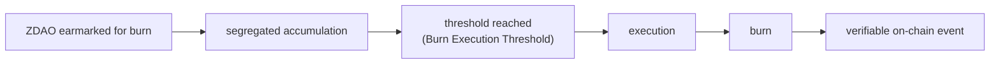

<!-- Origen: ZERO-ENERGY-Especificacion-Tecnica-v2.0.md -->

# 2. ZERO DAO (ZDAO)

ERC-20 governance and incentive token of the protocol, deployed on Base. **8 decimals**: the minimum unit is 0.00000001 ZDAO, the granularity required for the proportional calculation of rewards, fees, and distributions.

## 2.1 Supply magnitudes

The document precisely distinguishes six magnitudes that must not be confused:

|  |  |
| --- | --- |
| **Magnitude** | **Definition** |
| MAX_SUPPLY | 1,000,000,000 ZDAO. Absolute ceiling, never exceedable |
| CumulativeMinted | Total historically minted. Only grows, never decreases |
| totalSupply | ZDAO existing now (minted minus burned) |
| Circulating supply | totalSupply minus locked positions |
| Off-chain allocations | Rights registered in Presale and Merits, not yet minted |
| Burned ZDAO | Permanently destroyed |

**Invariant:** `CumulativeMinted <= MAX_SUPPLY`, verified on every mint.

## 2.2 Burning does not regenerate issuance capacity

This is the central economic rule of the supply and must be implemented explicitly.

Burned ZDAO are permanently destroyed. Burning **reduces `totalSupply` but does not reduce `CumulativeMinted`**, and therefore **does not free up minting capacity**.

Example:
 MAX_SUPPLY .............. 1,000M
 CumulativeMinted ........ 600M
 Burned .................. 100M
 totalSupply ............. 500M

 Remaining issuance capacity = 1,000M - 600M = 400M
 (NOT 500M: the 100M burned do not return)

Without this rule, every burn would open margin to mint again and the 1,000M ceiling would cease to be a real limit: a mint-and-burn cycle alone would suffice to issue indefinitely.

Consequences that must be respected in all protocol communications:

* A burn **must never be described as "new available supply"**.
* Any future extraordinary policy on issuance capacity requires express governance authorization, must respect MAX_SUPPLY and the immutable reserves, and **cannot be presented as an automatic consequence of a burn**.

## 2.3 Supply distribution

|  |  |  |  |
| --- | --- | --- | --- |
| **Program** | **Allocation** | **%** | **Nature** |
| Presale | 200,000,000 | 20 % | Foundational allocation (Section 5) |
| Merits and Ecosystem | 100,000,000 | 10 % | Single contribution bucket |
| Staking Rewards | 500,000,000 | 50 % | Immutable reserve (Section 6) |
| Strategic Issuances | 200,000,000 | 20 % | Requires express DAO approval |
| Total | 1,000,000,000 | 100 % |  |

**Merits and Ecosystem is a single bucket.** It comprises the founding team, contributors, ambassadors, and user onboarding campaigns. **There are no separate quotas by category.**

**Strategic Issuances.** Intended destinations, of an **indicative and non-binding** nature: market liquidity (150,000,000) and contingencies (50,000,000). Any issuance against this program requires a proposal approved by the DAO and the Section 8 timelock. There is no automatic minting mechanism against this line item.

**Staking Reserve.** The 500,000,000 are an **invariant**. They may not be allocated to treasury, team, liquidity, Merits, campaigns, strategic issuances, or any purpose other than the Official Staking System. Only the staking contract can mint them, and only when a reward has been legitimately accrued. **ZDAO not needed for rewards are not minted.**

## 2.4 Fungibility

All issued ZDAO are fully fungible. The origin of their issuance does not alter the nature of the asset nor the rights it confers.

A technical consequence derives from this, which the protocol respects in its design: **an ERC-20 cannot distinguish the provenance of the tokens that make up a balance.** Therefore no protocol rule depends on the origin of a specific ZDAO. The Genesis Right, which does depend on origin, is resolved outside the token (Section 5.3).

## 2.5 Functions

**Governance.** ZDAO confers voting rights over configurable economic parameters, community proposals, the composition of the Protocol Committee, Strategic Issuances, the destination of DAO Treasury resources, and protocol upgrades.

A precise distinction must be drawn: holders **decide by vote** the destination of the DAO Treasury. They hold no claim right over it nor participate in its distribution.

**Incentive.** ZDAO is the asset with which the protocol rewards participation in staking. Only those who hold deposited ZREC receive these rewards. ZDAO does not represent energy production.

**Relationship with protocol activity.** ZERO DEX fees are distributed among the DAO Treasury, liquidity providers, the burn mechanism, and infrastructure maintenance, according to the percentages in Section 7.

## 2.6 Burn mechanism

ZDAO contractually earmarked for burning **accumulate in a segregated and auditable manner** until a minimum execution threshold is reached.

**Initial Burn Execution Threshold: 10,000 ZDAO.** It is a governance-configurable parameter, not an economic constant.

The mechanism avoids hundreds of small-value burn operations, reduces operational cost, and maintains on-chain traceability. Neither the DAO nor the Committee intervenes at execution time: it triggers once the threshold is reached.

In accordance with Section 2.2, ZDAO burned by this mechanism do not regenerate issuance capacity.
