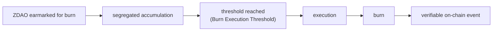

<!-- Origen: ZERO-ENERGY-Especificacion-Tecnica-v2.0.md -->

# 2. ZERO DAO (ZDAO)

ERC-20 governance and incentive token of the protocol, deployed on Base. **8 decimals**: the minimum unit is 0.00000001 ZDAO, the granularity required for the proportional calculation of rewards, fees, and distributions.

## 2.1 Supply magnitudes

The document distinguishes these magnitudes that must not be confused:

|  |  |
| --- | --- |
| **Magnitude** | **Definition** |
| MAX_SUPPLY | 1,000,000,000 ZDAO. Absolute ceiling, live in the ZDAO ERC-20 token. Never exceedable |
| totalSupply | ZDAO currently in existence (minted minus burned). This is the token's standard circulating metric |
| Circulating supply | `totalSupply` (ZDAO has no locked positions; see note below) |
| Minting capacity | `MAX_SUPPLY - totalSupply`, live in the ERC-20. **Recovered when ZDAO is burned** |
| stakingMinted | Cumulative ZDAO minted by the staking contract. **Only grows; burning does not reduce it**. Lives in the staking contract, capped at 500M (Section 6.3) |
| Off-chain allocations | Rights registered in Presale and Merits, not yet minted |
| Burned ZDAO | Permanently destroyed; reduces `totalSupply` |

**Invariants:**
- **ERC-20 (token):** `totalSupply <= MAX_SUPPLY`, verified on every mint.
- **Staking contract:** `stakingMinted <= 500,000,000`, verified on every staking-reward mint.

> **Separation of concerns.** `MAX_SUPPLY` lives in the ERC-20 token and bounds the global supply; `stakingMinted` lives in the staking contract and bounds only the reward issuance. ZDAO has **no locked positions**: staking rewards are free and transferable immediately (Section 6.5), and the Merits lock applies to the deposited ZREC principal, never to ZDAO.

ZDAO is **mintable and burnable** following the ERC-20 mintable/burnable capability: any holder may burn their own ZDAO, and burning reduces `totalSupply`, restoring minting capacity under `MAX_SUPPLY`. The staking reserve (500M) and the decreasing issuance curve (Section 6.3) bound reward issuance and are tracked by `stakingMinted`, which burn does not rewind.

## 2.2 Burning restores minting capacity (token), but not the staking cap

Burned ZDAO are permanently destroyed and **reduce `totalSupply`**, thereby **restoring minting capacity** under the ERC-20 `MAX_SUPPLY`.

Example:
 MAX_SUPPLY .............. 1,000M
 totalSupply ............. 600M
 Burned .................. 100M
 totalSupply (after) ..... 500M

 Remaining minting capacity = 1,000M - 500M = 500M
 (the 100M burned returned as available capacity)

This follows the standard ERC-20 burnable/mintable pattern: capacity is measured against the circulating `totalSupply`, so burning frees it.

**The staking cap is different.** `stakingMinted` is a monotonic counter held by the staking contract (capped at 500M, Section 6.3). Burning ZDAO — even ZDAO that came from staking rewards — does **not** reduce `stakingMinted`, so it does **not** restore the staking reserve or the halving curve. The staking contract can therefore never mint more than 500M in total, regardless of burning.

Consequences that must be respected in all protocol communications:

* A burn **may** be described as "restoring minting capacity under `MAX_SUPPLY`", but never as "compensating the staking reserve".
* Any future policy on the ceilings requires express governance authorization and cannot be presented as an automatic consequence of a burn.

## 2.3 Allocation limits

|  |  |  |  |
| --- | --- | --- | --- |
| **Program** | **Maximum limit** | **%** | **Nature** |
| Presale | up to 200,000,000 | 20 % | Genesis allocation (Section 5) |
| Merits and Ecosystem | up to 100,000,000 | 10 % | Single contribution bucket |
| Staking Rewards | up to 500,000,000 | 50 % | Immutable reserve (Section 6) |
| Strategic Issuances | up to 200,000,000 | 20 % | Requires express DAO approval |
| Total | 1,000,000,000 | 100 % |  |

This table expresses **maximum limits**, not fixed amounts to be minted. Actual issuance derives from real activity:

* **Presale and Merits** are linked to what is actually raised and claimed. Presale allocations may be resolved, at the participant's choice, into ZREC instead of ZDAO (Section 5.4); Merits allocations convert directly into ZREC (Section 5.5). The corresponding ZDAO are never minted.
* **Staking Rewards** are backed by an **immutable reserve of 500,000,000 ZDAO**: only the staking contract can mint against it, and only when a reward has been legitimately accrued. The reserve is a hard upper bound, not an obligation (Section 6.3).
* **Strategic Issuances** are an upper bound requiring express DAO approval.

The 500,000,000 staking reserve is an **invariant**: it may not be allocated to treasury, team, liquidity, Merits, campaigns, strategic issuances, or any purpose other than the Official Staking System. ZDAO not needed for rewards are not minted.

**The staking cap is cumulative.** The staking contract tracks `stakingMinted`, a monotonic counter that never decreases on burn. Although burning ZDAO restores general `MAX_SUPPLY` capacity (Section 2.2), it does **not** restore the staking reserve: the staking contract can never mint more than 500M in total across its lifetime, regardless of how much ZDAO is burned.

**Merits and Ecosystem is a single bucket** (abbreviated "Merits" throughout the document). It comprises the founding team, contributors, ambassadors, and user onboarding campaigns. **There are no separate quotas by category.**

**Strategic Issuances.** Intended destinations, of an **indicative and non-binding** nature: market liquidity (150,000,000) and contingencies (50,000,000). Any issuance against this program requires a proposal approved by the DAO and the Section 8 timelock. There is no automatic minting mechanism against this line item.

## 2.4 Fungibility

All issued ZDAO are fully fungible. The origin of their issuance does not alter the nature of the asset nor the rights it confers.

A technical consequence derives from this, which the protocol respects in its design: **an ERC-20 cannot distinguish the provenance of the tokens that make up a balance.** Therefore no protocol rule depends on the origin of a specific ZDAO. The Presale choice between ZDAO and ZREC (Section 5.4), which does depend on the allocation, is resolved outside the token.

## 2.5 Functions

**Governance.** ZDAO confers voting rights over configurable economic parameters, community proposals, the composition of the Protocol Committee, Strategic Issuances, the destination of DAO Treasury resources, and protocol upgrades.

A precise distinction must be drawn: holders **decide by vote** the destination of the DAO Treasury. They hold no claim right over it nor participate in its distribution.

**Incentive.** ZDAO is the asset with which the protocol rewards participation in staking. Only those who hold deposited ZREC receive these rewards. ZDAO does not represent energy production.

**Relationship with protocol activity.** ZERO DEX fees are distributed among the DAO Treasury, liquidity providers, the burn mechanism, and infrastructure maintenance, according to the percentages in Section 7.

## 2.6 Burn mechanism

ZDAO contractually earmarked for burning **accumulate in a segregated and auditable manner** until a minimum execution threshold is reached.

**Initial Burn Execution Threshold: 10,000 ZDAO.** It is a governance-configurable parameter, not an economic constant.

The mechanism avoids hundreds of small-value burn operations, reduces operational cost, and maintains on-chain traceability. Neither the DAO nor the Committee intervenes at execution time: **the burn is triggered automatically by the fee-consolidation routine (a keeper or any user's transaction) once the segregated accumulation reaches the threshold**, and it emits a verifiable on-chain event. The segregated accumulation is held in a dedicated contract balance separate from the circulating supply until execution.

In accordance with Section 2.2, ZDAO burned by this mechanism **reduce `totalSupply` and restore minting capacity under `MAX_SUPPLY`**, but do **not** restore the staking reserve (`stakingMinted` is untouched).
