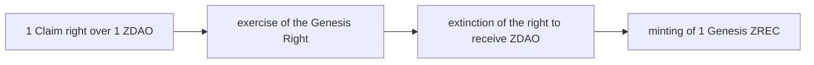
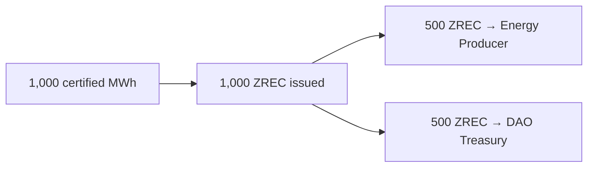

<!-- Origen: ZERO-ENERGY-Especificacion-Tecnica-v2.0.md -->

# 3. ZERO REC (ZREC)

Energy asset of the protocol and the **only asset depositable in the Official Staking System**. ERC-20 token on Base.

## 3.1 Standard and decimals

1 ZREC = 1 MWh = 1,000 kWh
0.1 ZREC = 100 kWh
0.01 ZREC = 10 kWh
0.001 ZREC = 1 kWh <- minimum representable unit

**3 decimals.** The correspondence with the energy unit is deliberate: the minimum unit of the token is exactly 1 kWh, which allows representing everything from residential microgeneration to industrial parks.

The precision difference with ZDAO (8 decimals) is intentional and EVM-compatible. Contracts must normalize both scales using safe integer arithmetic and explicit rounding rules, especially in the staking reward calculation, where ZREC is deposited and ZDAO is issued.

ZREC **has no maximum supply**. It grows as new energy production is certified.

## 3.2 Fungibility — a single token

ZREC is **a single fungible asset**. There are no distinct tokens for Presale Genesis ZREC, Merits Genesis ZREC, energy-production ZREC, or market-acquired ZREC.

Behavioral differences apply **to the position or the contract where the asset is deposited, never to the token**. A ZREC released from a Merits position is exactly the same asset as any other free ZREC.

Provenance may be kept as historical traceability information, but it does not affect fungibility.

This principle allows the Merits lock to exist without fragmenting the asset or market liquidity.

## 3.3 Two origins

|  |  |  |  |
| --- | --- | --- | --- |
| **Origin** | **When** | **How** | **Energy backing** |
| Genesis ZREC | Claim window (6 months) | Resolution of foundational allocations | No |
| Energy ZREC | Permanent, after the window | Certified production via PoE | Yes |

### A. Genesis ZREC

Allows the energy economy and staking to start before sufficient certified production exists. It is resolved **during the Claim**, according to the procedure in Section 5.

**There is no mint-and-burn operation.** When the Genesis Right is exercised, the corresponding ZDAO **never get minted on-chain**. The correct formulation is:

> The exercise of the Genesis Right extinguishes the Claim right over the corresponding amount of ZDAO and enables the equivalent minting of Genesis ZREC.

Once the six-month window ends, the mechanism is **disabled permanently and irreversibly**.

### B. Energy ZREC

The only ordinary source of issuance after the foundational window. It cumulatively requires real production, validation by Energy Oracles, and batch finalization in accordance with Section 4.

Distribution of each issuance:

The 50/50 split is governance-configurable between 30 % and 70 % for the Energy Producer's share.

**No initial per-producer issuance limit is established.** Governance may introduce one in the future if protocol development requires it.

## 3.4 Differentiated accounting

The protocol permanently and separately publishes:

* Genesis ZREC issued.
* Energy ZREC issued.
* ZREC withdrawn from circulation, by type.
* Percentage of the Genesis Issuance offset (Section 3.6).

The separation is **exclusively accounting-related**: it affects the published aggregates, not the units or fungibility.

It is necessary because during the foundational phase virtually all ZREC in circulation will come from the Genesis Issuance and therefore **will not represent energy actually produced**. Publishing both aggregates allows knowing at all times what proportion of the energy asset is backed by real production.

## 3.5 Economic value

ZREC has no predetermined price nor fixed parity with respect to ZDAO, any currency, or any other asset. **The protocol does not establish, sustain, or aspire to sustain any value for ZREC.** Its value is freely determined by the market.

## 3.6 Genesis Offset Program

It progressively and verifiably accredits that the foundational issuance has been matched by real renewable production.

When the DAO Treasury receives Energy ZREC, it may allocate them to the program:

1. Select ZREC accounted as Energy.
2. Permanently withdraw them from circulation by burning.
3. Issue the corresponding **Genesis Offset NFT**.
4. Increment the public cumulative offset counter.

**Scope and limits.** The program **does not modify, replace, or individually back** the Genesis ZREC issued. It confers no right of exchange, redemption, or claim over energy. Its function is **accounting and demonstrative**: to publicly attest that the protocol has generated, certified, and withdrawn an amount of real renewable energy equivalent to a fraction of its foundational issuance.

**Single-use rule.** A certified MWh cannot be counted twice. The Genesis Offset NFT is issued in the name of the DAO Treasury, is marked with that purpose, and **is not transferable nor usable as an environmental offset certificate by third parties**.

## 3.7 Energy Certification NFT

Energy certificate of the protocol. Each NFT represents certified renewable energy permanently withdrawn from circulation, and includes: unique identifier, Energy Producer and source installation, date, certified amount, Oracle validation reference, verifiable hash, and **purpose** (third-party offset or Genesis Offset).

The purpose field determines the regime: Genesis Offset certificates are governed by Section 3.6 and are not transferable.

> **Delimitation.** ZREC certifies **renewable generation verified by the protocol**. The NFT certifies the **withdrawal** within the protocol. Neither automatically equates to an official Guarantee of Origin, an I-REC, or any other regulated certificate, unless the corresponding integration and accreditation exists. This distinction must be maintained in all communications.
