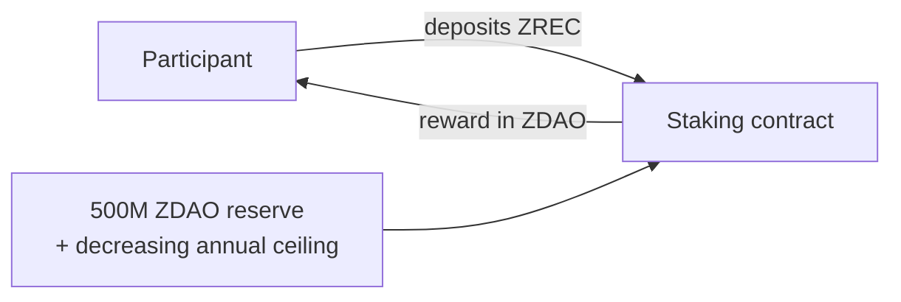
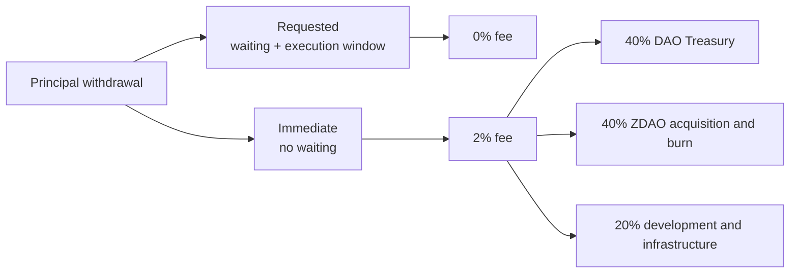

<!-- Source: Protocol Technical Specification v1.0, approved on 30 Sep 2026 (English reference version). ZEROEnergyDAO/ZERO-Energy-Docs, 04_Protocol @ 07b48a6 -->

# 6. OFFICIAL STAKING SYSTEM

**ZREC** is deposited and **ZDAO** is received. It is the only mechanism through which the 500,000,000 ZDAO of the rewards reserve can be minted, within the limit of the decreasing curve (Section 6.3).

## 6.1 Technical basis

The Official Staking System is a **proprietary development of ZERO Energy, with its own rules**: a decreasing rewards model in which the annual rate is 100% in the first year and halves each year, with an issuance ceiling of 250,000,000 ZDAO in the first year that also halves each year.

The asset that is deposited (ZREC) and the one received as a reward (ZDAO) are different, which requires explicitly defining the relationship between the two and the normalization between their decimal scales (3 in ZREC, 8 in ZDAO).

> Sections 6.2 (rewards model) and 6.3 (issuance limits) are in [`mathematics/01-rewards-model.md`](../mathematics/01-rewards-model.md).

## 6.4 Position types

The system uses **individualized positions**, each with its own amount, entry date, age, accumulated rewards, type, status and withdrawal availability. Each contribution constitutes an independent position with its own age computation.

| | | |
| --- | --- | --- |
| | **Free staking** | **Merits staking** |
| Applicable to | Presale ZREC, Energy ZREC, market ZREC | ZREC from the Merits conversion |
| Entry | Voluntary | Automatic during the Claim |
| Lock | No | Initial 6 months |
| Availability | General withdrawal rules | 2% monthly for 50 months (vesting) |
| Rewards | General model | General model, identical |

**Both types use the same ZREC.** No distinct versions of the token are created to represent its provenance (Section 3.2). The difference lies **exclusively in the principal withdrawal rules**.

## 6.5 Rewards of Merits positions

Merits ZREC **generate rewards from the start of their position, including the six-month lock period**, under the same general economic model. There is no differentiated formula.

The ZDAO generated as rewards:

* come exclusively from the staking reserve, not from the Merits Program;
* **do not inherit the lock** of the ZREC that generated them;
* are free as soon as they are distributed.

## 6.6 Withdrawal

Two modalities for free positions and for the available portion of Merits positions:

| | | |
| --- | --- | --- |
| **Modality** | **Procedure** | **Fee** |
| Requested | Waiting period + execution window | 0% |
| Immediate | No waiting period | 2% of the principal withdrawn |

**Immediate withdrawal fee: 2% initially** on the principal withdrawn. This is the initial value, not a permanent value: the DAO may modify it by vote within the **range of 0.50% to 5.00%**.

**Initial fee split**, modifiable by governance within the limits of the protocol:

| | |
| --- | --- |
| **Destination** | **Initial** |
| DAO Treasury | 40% |
| ZDAO acquisition and burn | 40% |
| Development and infrastructure | 20% |
| Liquidity providers | 0% |

This fee is independent of the ZERO DEX fees and does not necessarily follow their split. The portion allocated to acquisition and burn is accumulated and executed according to the Burn Execution Threshold of Section 2.6.

**Merits positions.** Immediate withdrawal does not allow the lock to be circumvented: during the first six months, no principal may be withdrawn through either route. Thereafter, only the amount already available according to the progressive release of 2% monthly over 50 months may be withdrawn (Section 5.5).
